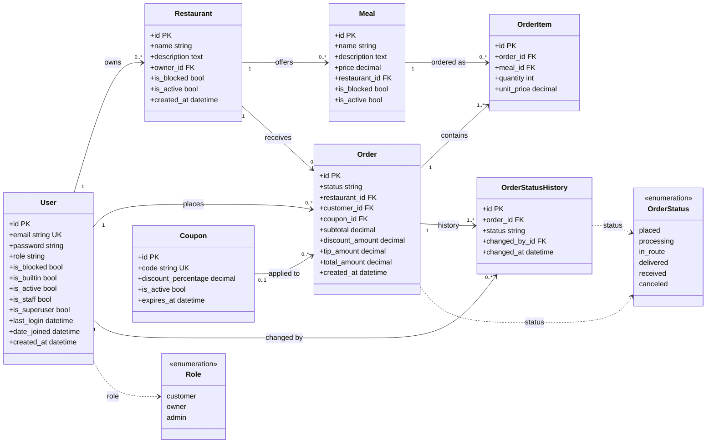

# Food Delivery API

A REST API for a food delivery service, built with Django and Django REST Framework.

- **Customers** browse restaurants and meals, place orders (several meals from one restaurant, an optional tip and an optional percentage coupon) and follow them through their statuses.
- **Restaurant owners** manage their own restaurants and meals and move the orders of their restaurants through the status flow.
- **An administrator** can create, read, update, delete and block users, restaurants and meals. There is exactly one administrator, the built-in one, and it cannot be changed or deleted through the API.

## Contents

1. [Tech stack](#tech-stack)
2. [Setup](#setup)
3. [Seed data](#seed-data)
4. [Authentication](#authentication)
5. [Roles and access](#roles-and-access)
6. [Data model](#data-model)
7. [API reference](#api-reference)
8. [Orders](#orders)
9. [Response conventions](#response-conventions)
10. [Trying the API](#trying-the-api)
11. [Design decisions](#design-decisions)
12. [Tests](#tests)
13. [Known limitations](#known-limitations)

## Tech stack

| Part | Choice |
|---|---|
| Language | Python 3.14 |
| Framework | Django 6.1, Django REST Framework 3.18 |
| Auth | JWT (`djangorestframework-simplejwt`), `Authorization: Bearer <token>` |
| Database | MySQL (via `mysqlclient`) |
| Config | `django-environ`, values read from a `.env` file |

## Setup

### 1. Prerequisites

- Python 3.14
- MySQL running on `127.0.0.1:3306`
- The system libraries `mysqlclient` needs to build (on macOS: `brew install mysql pkg-config`)

### 2. Install

```bash
python -m venv .foodenv
source .foodenv/bin/activate
pip install -r requirements.txt
```

### 3. Create the database

The database name is fixed in `config/settings.py` as `food_delivery_db`.

```sql
CREATE DATABASE food_delivery_db CHARACTER SET utf8mb4;
```

The MySQL user also needs permission to create databases, because the test suite creates and drops its own `test_food_delivery_db`.

### 4. Create the `.env` file

Create a file called `.env` in the project root (it is git-ignored). All seven variables are required.

```ini
DEBUG=True
SECRET_KEY=change-me-to-a-long-random-string
DB_USER=your_mysql_user
DB_PASSWORD=your_mysql_password
ADMIN_EMAIL=admin@example.com
ADMIN_PASSWORD=choose-a-strong-password
SEED_USER_PASSWORD=choose-another-strong-password
```

| Variable | Used for |
|---|---|
| `DEBUG` | Django debug mode (`True` or `False`) |
| `SECRET_KEY` | Django signing key; JWTs are signed with it |
| `DB_USER`, `DB_PASSWORD` | MySQL credentials |
| `ADMIN_EMAIL`, `ADMIN_PASSWORD` | The built-in administrator created by `init_db` |
| `SEED_USER_PASSWORD` | Password given to every demo customer and owner |

Both passwords must pass Django's password validators (not too short, not too common, not too similar to the email, not entirely numeric).

### 5. Migrate and seed

```bash
python manage.py migrate
python manage.py init_db
python manage.py runserver
```

The API is then available at `http://127.0.0.1:8000/api/`.

`init_db` is safe to run more than once. It runs these commands in order, and each can also be run on its own:

| Command | What it does |
|---|---|
| `create_admin` | Creates the one built-in administrator from `ADMIN_EMAIL` and `ADMIN_PASSWORD`. Refuses to run a second time. |
| `init_users` | Creates the demo customers. |
| `init_restaurants_and_meals` | Creates the demo owners, restaurants and meals. |
| `init_coupons` | Creates or updates the demo coupons. |
| `init_orders` | Creates demo orders in several statuses. Skipped if any order already exists. |

## Seed data

| Account | Email | Password |
|---|---|---|
| Built-in administrator | the value of `ADMIN_EMAIL` | `ADMIN_PASSWORD` |
| Customers | `customer1@test.com` to `customer5@test.com` | `SEED_USER_PASSWORD` |
| Owners | `owner1@test.com` to `owner3@test.com` | `SEED_USER_PASSWORD` |

There are six restaurants with their meals (Bombay Brasserie, Mama Rosa's Trattoria, Sakura Sushi & Ramen House, El Camino Taqueria, Bangkok Garden, Fresh & Co. Salad Kitchen) and ten demo orders covering every status.

Coupons: `WELCOME10` (10%), `SAVE15` (15%), `SAVE20` (20%), `SAVE50` (50%).

There is no coupon endpoint. Coupons are managed in the Django admin site at `/admin/`, where you can log in as the built-in administrator.

## Authentication

1. `POST /api/auth/register/` creates a customer or owner and returns tokens.
2. `POST /api/auth/login/` returns tokens for an existing user.
3. Send the access token on every other request: `Authorization: Bearer <access_token>`.

- The access token lasts 30 minutes. A refresh token is returned too, but **there is no refresh or logout endpoint**; log in again when the token expires.
- A **blocked** user cannot log in (403) and an existing token stops working (401). Unblocking restores both.
- A **deleted** user (an inactive account) cannot log in, and an existing token stops working (401).
- Only `customer` and `owner` can be chosen when registering. The administrator role cannot be created through the API.

## Roles and access

| Area | Customer | Owner | Admin |
|---|---|---|---|
| Register, login | yes | yes | yes |
| Browse restaurants and meals | yes (visible ones) | yes (own) | no |
| Create, update, delete restaurants and meals | no | own only | via `/api/admin/` |
| Place orders | yes | no | no |
| View orders | own orders | orders of own restaurants | no |
| Change order status | limited (see below) | limited (see below) | no |
| Manage users, restaurants and meals | no | no | yes |

Requests without a valid token get **401**. A logged-in user calling an endpoint their role may not use gets **403**.

## Data model



`User` is a custom model that logs in by email. Django's other built-in user columns (such as `first_name`) exist as well but are not used.

| Table | Rules enforced by the database |
|---|---|
| `User` | `email` is unique |
| `Meal` | `price` is at least 0.01 |
| `Coupon` | `code` is unique; `discount_percentage` is between 0 and 100 |
| `Order` | `subtotal`, `discount_amount` and `tip_amount` are not negative; `coupon_id` is optional |
| `OrderItem` | `quantity` is at least 1; `unit_price` is at least 0.01; a meal appears at most once per order |

Every foreign key is `PROTECT`: a user, restaurant or meal that an order refers to cannot be removed from the database. The API therefore deletes by setting `is_active` to false. An order also keeps its own copies of the prices (`unit_price`, `subtotal`, `discount_amount`, `tip_amount`, `total_amount`), so it does not change when a meal's price does.

## API reference

All paths are relative to `/api/`. List endpoints are paginated.

### Auth endpoints

| Method | Path | Body | Notes |
|---|---|---|---|
| POST | `auth/register/` | `email`, `password`, `role` (`customer` or `owner`) | 201 with `user` and `tokens` |
| POST | `auth/login/` | `email`, `password` | 200 with `user` and `tokens` |

### Restaurants and meals (customers and owners)

| Method | Path | Who | Notes |
|---|---|---|---|
| GET | `restaurants/` | customer, owner | Customers see every visible restaurant. Owners see their own, including blocked ones. |
| POST | `restaurants/` | owner | Body: `name`, `description`. The owner is taken from the token. |
| GET | `restaurants/{id}/` | customer, owner | |
| PUT, PATCH | `restaurants/{id}/` | owner | Own restaurants only. 403 if blocked by an admin. |
| DELETE | `restaurants/{id}/` | owner | Soft delete. 403 if blocked. |
| GET | `restaurants/{id}/meals/` | customer, owner | Customers see only available meals. Owners see their blocked meals too. |
| POST | `restaurants/{id}/meals/` | owner | Body: `name`, `description`, `price` |
| GET | `restaurants/{id}/meals/{meal_id}/` | customer, owner | |
| PUT, PATCH | `restaurants/{id}/meals/{meal_id}/` | owner | 403 if the meal or its restaurant is blocked |
| DELETE | `restaurants/{id}/meals/{meal_id}/` | owner | Soft delete. 403 if blocked. |

Customers get fewer fields (`id`, `name`, `description` and, for meals, `price`). Owners also see `is_blocked`.

### Order endpoints

| Method | Path | Who | Notes |
|---|---|---|---|
| GET | `orders/` | customer, owner | A customer sees their own orders. An owner sees the orders of their restaurants. Newest first. |
| POST | `orders/` | customer | See [Orders](#orders) |
| GET | `orders/{id}/` | customer, owner | Includes `status_history`. 404 for anyone else's order. |
| POST | `orders/{id}/status/` | customer, owner | Body: `{"status": "..."}` |

### Administrator (`/api/admin/`)

Every path below requires the administrator. A deleted user, restaurant or meal still appears in admin lists and can be restored with `PATCH {"is_active": true}`.

| Method | Path | Notes |
|---|---|---|
| GET, POST | `admin/users/` | Create body: `email`, `password`, `role` (`customer` or `owner`) |
| GET, PUT, PATCH, DELETE | `admin/users/{id}/` | Update fields: `email`, `password` (write-only), `role`, `is_active`, `is_blocked`. The built-in administrator cannot be updated, blocked or deleted (403). |
| GET, POST | `admin/restaurants/` | Create body: `name`, `description`, `owner` (an active, unblocked owner) |
| GET, PUT, PATCH, DELETE | `admin/restaurants/{id}/` | Update also accepts `is_active` and `is_blocked` |
| GET, POST | `admin/meals/` | Create body: `name`, `description`, `price`, `restaurant` (an active, unblocked restaurant) |
| GET, PUT, PATCH, DELETE | `admin/meals/{id}/` | Update also accepts `is_active` and `is_blocked` |

`PUT` needs every field of the update body. `PATCH` accepts any subset.

## Orders

### Placing an order

`POST /api/orders/` as a customer:

```json
{
  "restaurant_id": 1,
  "items": [
    {"meal_id": 3, "quantity": 2},
    {"meal_id": 4, "quantity": 1}
  ],
  "tip_amount": "3.00",
  "coupon_code": "SAVE10"
}
```

- `restaurant_id` and `items` are required. `tip_amount` (default `0`) and `coupon_code` are optional.
- Every meal must belong to that restaurant and be available. A meal can appear only once; use `quantity` instead.
- The restaurant must be visible: active and unblocked, with an active and unblocked owner.
- Quantities are whole numbers of at least 1. The tip is not negative and at most 9999.99.
- The coupon must exist, be active and not be expired. Surrounding spaces in the code are ignored. A coupon can be used on any number of orders.

### Prices

```
subtotal = sum of (meal price x quantity)
discount = subtotal x coupon percentage / 100, rounded half up to 2 decimals
total    = subtotal - discount + tip
```

Coupons are whole percentages. Each item stores the meal's price at the time of the order (`unit_price`), so changing a meal's price later does not change old orders. All money values are returned as strings with two decimals, for example `"28.50"`.

### Status flow

```
placed -> processing -> in_route -> delivered -> received
   \           \
    +-----------+--> canceled
```

| From | Owner can set | Customer can set |
|---|---|---|
| `placed` | `processing`, `canceled` | `canceled` |
| `processing` | `in_route`, `canceled` | none |
| `in_route` | `delivered` | none |
| `delivered` | none | `received` |
| `received` | none | none |
| `canceled` | none | none |

The administrator cannot change a status. `received` and `canceled` are final.

The status endpoint answers:

| Code | Meaning |
|---|---|
| 200 | The status changed; the order is returned |
| 400 | Unknown status, or nobody can make that move (for example `placed` to `in_route`, or any move out of a final status) |
| 403 | The move exists, but only for the other role (for example a customer asking for `processing`) |
| 404 | The order does not exist, or it is not yours |

Every change is saved in `status_history` with the new status, who made it and when, starting with the `placed` entry made when the order is created.

## Response conventions

- **Messages and errors** use one key: `{"detail": "..."}`. This covers success messages (`"Restaurant deleted successfully"`), login errors, permission errors and 404s.
- **Validation errors** keep the field-keyed shape: `{"email": ["A user with a@b.com already exists"]}`. Order rules that are not tied to one field use `{"detail": "..."}` with 400.
- **Pagination** is the same on every list: `{"count": 25, "next": "...?page=2", "previous": null, "results": [...]}`. The page size is fixed at 20, and `?page=N` picks the page. A page past the end returns 404.
- **Status codes:** 201 for creates, 200 for reads, updates and deletes, 400 for invalid input, 401 for a missing or invalid token, 403 for the wrong role or a blocked item, 404 for something that does not exist or is not yours.
- Passwords are never returned.

## Trying the API

Start the server first - `python manage.py runserver`

### Postman

A Postman collection with a request for every endpoint is present in the repository as `food_delivery.postman_collection.json`

1. In Postman, choose **Import** and select the collection file.
2. Send a login request for the role you want to try (the seed accounts are listed under [Seed data](#seed-data)).
3. Use the returned `access_token` as the Bearer token on the other requests.

## Design decisions

- **Soft delete.** Deleting a user, restaurant or meal sets `is_active` to false instead of removing the row. Orders keep pointing at everything they used, and every foreign key is `PROTECT`, so the database refuses a hard delete that would orphan an order. The administrator can restore anything with `{"is_active": true}`.
- **Blocking is separate from deleting.** A blocked item stays in place but is hidden from customers. Its owner still sees it, marked `is_blocked`, but cannot change or re-enable it.
- **Visibility.** A customer sees a restaurant only if the restaurant and its owner are both active and unblocked, and a meal only if it is also active and unblocked. Blocking or deleting an owner hides their restaurants without changing them.
- **One administrator.** The assignment asks for a single built-in administrator, so the `admin` role cannot be created or assigned through the API, and the built-in account returns 403 on any update, block or delete. `create_admin` refuses to create a second one.
- **Prices are snapshots.** Each order item stores the meal's price at purchase time, and the order stores its subtotal, discount, tip and total, so later changes never rewrite history.
- **Status rules in one table.** The allowed moves live in `food_delivery/constants.py` as `(from, to) -> roles`. Changing a status locks the order row, so two simultaneous requests cannot both succeed.
- **Not yours looks like not found.** Another customer's order, another owner's restaurant and a non-participant's status change all return 404, so ids cannot be probed.
- **Fail closed.** Each view lists the methods it allows and which roles may use them. Anything else, including `HEAD` and `OPTIONS`, is denied.
- **Input is whitelisted.** Serializers accept only the fields they list, so a client cannot set `is_blocked`, `owner`, prices, totals or `status` by adding them to a body.

## Tests

```bash
python manage.py test
```

The suite uses Django's test runner with DRF's `APIClient`, so every test talks to the real endpoints, including real JWT login, and runs against a temporary `test_food_delivery_db` that is created and dropped automatically.

| File | Covers |
|---|---|
| `user/tests.py` | Registration rules, login, blocked and deleted accounts, tampered, expired and unknown tokens |
| `food_delivery/tests.py` | Owner restaurant and meal management, customer browsing and hidden items, placing orders (totals, coupons, snapshots, validation), customer and owner order views, the status rules, and end-to-end order flows |
| `admin_api/tests.py` | Administrator management of users, restaurants and meals, blocking and restoring, and the protection of the built-in administrator |
| `config/base_test.py` | Shared test helpers (not tests) |

To run one area: `python manage.py test user`, `python manage.py test food_delivery.tests.OrderStatusTests`, and so on.

## Known limitations

- **No token refresh or logout.** An access token cannot be revoked; a blocked or deleted account is rejected on the next request instead.
- **The built-in administrator is protected at the API level only.** It can still be changed from `python manage.py shell`, the Django admin site, raw SQL, or a bulk queryset `delete()`.
- **No per-user coupon limits.** A coupon can be reused on any number of orders until it expires or is deactivated.
- **No search, filtering or sorting on lists.** Lists are paginated only.
- **`HEAD` and `OPTIONS` are not supported** and return 403 for logged-in users.
- **Login emails are matched by the database.** Emails are stored in lower case, and logging in with a different case works because MySQL's default collation ignores case. On a case-sensitive database, the login serializer would need to lowercase the email.
- **Payments, addresses and notifications are out of scope.**
